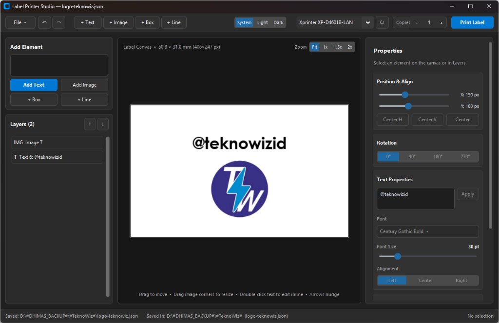

<div align="center">

# Label Printer Studio

**Windows 11 Fluent-styled desktop application for designing and printing thermal sticker labels (`50.8mm × 31mm`, 203 DPI)**

Built and maintained by **TeknoWiz Indonesia** (`@teknowizid`)

[](https://github.com/teknowizid/stiker-label)
[](https://www.python.org/)
[](https://github.com/TomSchimansky/CustomTkinter)
[](#-license)
[](https://github.com/teknowizid)

<br>



<br>

*3-panel Windows 11 studio workspace featuring live interactive canvas, dark/light themes, and direct thermal printer output.*

</div>

---

## ✨ Key Features

| Category | Capabilities |
| :--- | :--- |
| **🎨 Windows 11 Fluent UI** | Clean 3-panel workspace (**Add & Layers**, **Interactive Canvas**, **Properties Inspector**), **Light / Dark / System** theme switching, and native Windows 11 DWM titlebar styling. |
| **✏️ Text & Emoji** | Multi-line text support (including emoji), `Left` / `Center` / `Right` alignment, and **inline editing directly on the canvas** via double-click. |
| **🖼️ Images & Shapes** | Upload `.jpg`, `.png`, `.bmp`, `.webp` images and add **Box** (outlined or filled) & **Line** shapes with adjustable thickness (`1–20 px`). |
| **📐 Interactive Canvas** | Drag-and-drop positioning, **corner resize handles** for images and shapes, **snap guide lines** (canvas center & other elements), zoom presets (`Fit`, `1x`, `1.5x`, `2x`), and rotation (`0°`, `90°`, `180°`, `270°`). |
| **🔤 Filterable Font Picker** | Floating Windows-style font selector displaying clean Windows Registry font names (`.ttf` / `.otf`) with real-time keyword filtering. |
| **↩️ History & Protection** | Up to 50 steps of **Undo / Redo** (`Ctrl+Z` / `Ctrl+Y`), `*` unsaved changes indicator, and save confirmation on exit or file switch. |
| **💾 File Menu & Autosave** | Unified **`File`** menu (`New`, `Open`, `Open Recent` up to 10 projects, `Save`, `Save As`, `Autosave` toggle, `Print`, `Exit`). Immediate **Autosave** + crash-recovery draft in `%APPDATA%\LabelPrinterStudio\autosave_draft.json`. |
| **🖨️ Direct Thermal Print** | One-click printing to Windows printers via `pywin32`, with printer list refresh (`↻`) and copies stepper. |

---

## ⌨️ Keyboard Shortcuts

| Shortcut | Action |
| :--- | :--- |
| `Ctrl+N` | New / Clear label |
| `Ctrl+O` | Open `.json` project |
| `Ctrl+S` | Save project (overwrites active file without re-prompting) |
| `Ctrl+Shift+S` | Save As |
| `Ctrl+P` | Print label |
| `Ctrl+Z` / `Ctrl+Y` | Undo / Redo |
| `Ctrl+D` | Duplicate selected element |
| `Delete` | Delete selected element |
| `Arrow Keys` / `Shift+Arrow` | Nudge selected element (`1 px` / `10 px`) |
| `Double-Click` (on text) | Edit text inline (`Enter` apply, `Shift+Enter` newline, `Esc` cancel) |

---

## 🚀 Quick Start

### 1. Clone & Install
```bash
git clone https://github.com/teknowizid/stiker-label.git
cd stiker-label
pip install -r requirements.txt
```

### 2. Run the Application
- **Instant Launch (Windows)**: Double-click **`run.bat`** *(auto-detects Python and installs missing dependencies if needed)*.
- **Via Terminal**:
  ```bash
  python run.py
  ```

---

## 🧪 Testing & Building `.exe`

### Run Test Suite
```bash
python -m pytest -v tests/test_parsing.py tests/verify_logic.py tests/verify_saveload.py tests/reproduction_rotation.py
```

### Build Standalone Windows Executable
```bash
python build_exe.py
```
The compiled `LabelPrinter.exe` will be output to the `dist/` folder.

---

## 📁 Project Structure

```text
stiker-label/
├── app/
│   ├── main.py             # Windows 11 Fluent UI, canvas interactions, menus & autosave
│   ├── label_designer.py   # Pillow canvas rendering, shapes, text/images & snapshots
│   ├── font_manager.py     # Windows Registry TTF/OTF font catalog
│   ├── printer_utils.py    # Direct Windows GDI printing via pywin32
│   └── logging_config.py   # UTF-8 application logging setup
├── assets/
│   └── preview.jpg         # Application UI screenshot
├── tests/                  # Pytest & verification scripts
├── run.bat                 # One-click Windows launcher (no build required)
├── run.py                  # Python entry point
├── build_exe.py            # PyInstaller standalone .exe builder
├── CHANGELOG.md            # Version release history
└── requirements.txt        # Python dependencies
```

---

## 📄 License

MIT License

<div align="center">

---

Made with ❤️ by **TeknoWiz Indonesia**  
GitHub: [@teknowizid](https://github.com/teknowizid) • Email: `root.teknowiz@gmail.com`

</div>
